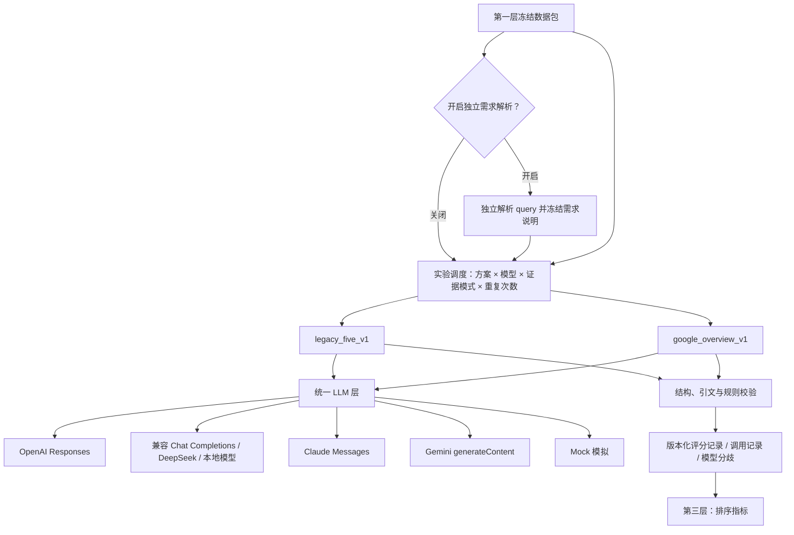

# 第二层：评估方案与模型实验

使用 `quality_eval` 命令执行实验。离线示例使用模拟评分器。批量运行的执行情况见[实验进展](PROGRESS.md)。

## 结构



评估方案、模型协议和实验调度分别存放：

| 位置 | 职责 |
| --- | --- |
| `quality_eval/schemes.py` | 方案注册表、任务范围、输入投影、缺证据处理 |
| `quality_eval/prompts/` | 可查看和修改的版本化评分提示词 |
| `quality_eval/contracts.py` | 输出 schema、逐字引用检查、分档约束 |
| `quality_eval/query_specs.py` | 独立需求解析与冻结 |
| `quality_eval/execution.py` | 执行、缓存、失败状态、显式重试 |
| `quality_eval/runner.py` | 并行实验、记录展开、同条件模型比较 |
| `quality_llm/` | 厂商协议、认证、限流、超时和传输重试 |

评分方案不直接调用厂商 SDK；厂商适配器不包含评分标准。
目前仍仅使用 Python 3.9+ 标准库。

## 已实现的方案

| 方案 | 任务粒度 | 输出 |
| --- | --- | --- |
| `legacy_five_v1` | 单 URL，一次调用输出四维；另有结果列表任务 | answerability、authoritative、freshness、noise、duplicate |
| `google_overview_v1` | Needs Met 和 Page Quality 各自独立任务 | needs_met、page_quality |

### 旧目录五维方案

源定义为本机 evaluation 包中的
`context-search-quality-evaluation/SKILL.md`。
迁移保留 `-1/0/1/2/3` 可回答性、S1/S2 对应权威性、query 时间要求、
0/-1 强制噪声及同 query/同运行列表内的重复规则。

关键边界：

- 2 分要求完整答案已存在但需消歧，不能把“部分完成”给 2 分。
- S1 只能来自配置的人工认可域名列表；没有列表不允许模型发明认可来源。
- 0/-1 必须 noise=true；有时间要求的 query 中，这类结果必须 freshness=false。
- duplicate 单独判断，不能看到单 URL 就臆测列表重复。
- 不截取旧候选脚本中的前 500 字，不把供应商和检索分数传给单 URL 评分器。

这是**按原定义重建的候选实现**。原包 README 明确说明，最终 GPT 分片复核不存在
可忠实复现的单一完整 system prompt，因此本方案不声称复现最终历史评分。
旧体系规则版本 1.1 已移除 `unjudgeable` 评分状态：可回答性必须为 -1/0/1/2/3，
权威性、噪声、重复性必须为 Boolean，时效性只有无时间需求时可 N/A。
来源身份缺证时不判 S1/S2，按可见来源类型或 S5 判非权威；时效关键证据不足时判不满足，
但不自动声称已过期或给 -1。未见重复证据判非重复并说明证据范围。空内容可判 0 和噪声，
不强制为“没有内容”伪造引文。2/3 分要求完整答案、必要条件、时间和正确性判断一致。
官方文档直接回答所问参数时，不额外要求未被请求的完整教程；混合信息中的完整正确答案仍可为 2。
解析歧义或缺少时间基准不再阻断全部旧体系维度，仍可按可见证据判明显不相关的 0 分。
缺失网页快照、采集失败、需求解析失败、输入超限或模型调用失败属于执行错误，保留 null，
不充当质量评分。已确认 401/403/404/410 或完整抓取后的空页面则作为可评证据交给评分器。
独立证据模式是新管道扩展；历史 1.0 记录及 Prompt 快照保持原样，不套用新规则改写旧分数。
独立 Golden Answer 可在 prepare 阶段导入；未提供时如实保留缺失，不从模型记忆补造金标。

### Google Overview 方案

来源：[Google Search Quality Rater Guidelines: An Overview](https://services.google.com/fh/files/misc/hsw-sqrg.pdf)，重点为印刷页 19–31。

本项目使用 Needs Met 与 Page Quality 两个不同的分类轴，
保留 `FailsM/SM/MM/HM/FullyM` 和 `Lowest/Low/Medium/High/Highest` 标签。
它是受 Overview 启发的工程实现，未经人工校准，也不是 Google 官方自动评估器。

特别注意：

- API 模式的 Needs Met 是可见 API 证据的代理判断，输出 `rating_target=api_evidence`。
- 页面模式需要独立快照，不把摘要当作网页。
- PQ 总是使用 `mode=page_content` 和 `rating_target=page_snapshot`，即使所在实验的 Needs Met 使用 API 模式。
- PQ 不收到 query 文本或候选排名，仅收到页面和时间/语言/地区上下文。
- FullyM 资格必须在需求解析阶段预先批准，只允许明确寻找一个特定目标的查询；
  不采用此前项目 URL-NM 标准对一般有限问答 N4 的扩展。
- 缺少决定性证据时保留未知状态；不把 PQ、NM 和旧 answerability 做数值相加或强行换算。

完整的自动化边界、缺证据处理和规则校验属于本项目设计，不是对完整人工指南的替代。

## 可选的需求解析

配置 `query_understanding` 支持两种模式，省略时默认为 `frozen`，兼容原有行为。

| 模式 | 行为 |
| --- | --- |
| `frozen` | 先调用 `query_model` 解析需求，再共用固定需求说明进行评分 |
| `direct` | 跳过 prepare；评分模型在同一次评分调用中直接理解原始 query，`query_model` 不使用 |

前端通过“解析 query 需求”开关选择模式。关闭时无需配置解析模型或获取其可用型号。
CLI 使用 `direct` 时，在配置顶层增加 `"query_understanding": "direct"`，
然后直接执行 `plan` / `run`，不传 `--specs`；`prepare` 会明确提示该模块已关闭。
为防止混用旧需求，`direct` 模式传入 `--specs` 会报错。

`direct` 的 URL 评分输出包含 `query_assessment` 和以文本描述的需求、约束检查，
保留评分模型当次的需求理解；不生成独立需求文件，也不伪造冻结需求或参考答案。
不同评分模型、URL、轮次可能形成不同理解，模型一致率也可能受到理解差异的影响。
时效、必要条件、FullyM 资格和证据引用仍需校验；缺少网页时 PQ 仍为无法判断。
任务、评分记录和报告保存 `query_understanding`，任务身份、提示词及模式共同参与比较匹配，
不会将两种模式的评分当作相同实验条件混合比较。

### 开启时先冻结需求

准备阶段只提供 query、独立上下文和评价时间，不提供任何候选 URL。
一个指定的 `query_model` 生成需求说明，所有评分模型共用同一份结果。

需求说明包含：

- 合理意图及其主次关系；
- 每个意图的实质需求、必要条件；
- 时间要求与旧体系的 F1–F5 诊断标签；
- 是否符合本方案 FullyM 的单目标条件；
- 是否存在必须澄清的歧义。

每条记录绑定 `dataset_version`、原 query、模型、prompt 哈希和 `spec_hash`。
需求解析失败或要求澄清时，对应 URL 需求评分保留无法判断。
语义重复和 PQ 不依赖 query_spec 的答案理解；PQ 的输入也不包含 query_spec。

需求说明由模型生成，仍可能有误。正式模型基准测试前，应对其独立审核并校准；
当前命令提供自动准备和版本冻结，尚未提供人工审核界面。
不要把所有模型的一致判断当成需求解释正确的证据。

### 导入独立参考答案

prepare 可增加 `--reference-answers references.json`。文件示例：

```json
{
  "your-query-id": {
    "answer": "独立、已经核验的参考答案",
    "source": "证据来源或人工核验记录",
    "as_of": "2026-10-20T05:36:00Z"
  }
}
```

这些材料与需求说明一起冻结，不由需求生成模型补写。
评分器只能用它们核验，不能把参考答案作为候选结果自身的贡献。
API 返回的发布时间、采集时间和参考答案时间不得相互冒充。

## 模型配置

`examples/evaluation.mock.json` 可直接离线运行。
`examples/evaluation.models.template.json` 是真实接口模板，必须先填写实际 model ID、
兼容服务地址，并设置对应环境变量。可以删除不用的模型/实验。
其中 DeepSeek、千问AI平台和智谱已有独立完整配置；其他带 `REPLACE_` 的配置仍需填写。
配置不假定当前账户拥有某个模型。

千问AI平台使用 `examples/evaluation.qianwen.json` 与 `QIANWEN_API_KEY`。
默认 OpenAI Chat 兼容流式请求，合并可见文本后沿用原来的 JSON、Schema 和证据校验。
`catalog_models` 是平台不支持 `/models` 时显式指定的本地型号列表，不代表账户权限验证。
前端可分别选择评分和解析型号，详见 [千问接入说明](frontend/README.md#千问ai平台)。
流式结束缺失、网络中断和无有效回答时保存诊断并返回失败，不自动重新采样；内部推理块不落盘。

智谱使用 `examples/evaluation.zhipu.json` 与 `ZHIPU_API_KEY`，官方端点为
`https://open.bigmodel.cn/api/paas/v4/chat/completions`，型号为 `glm-4.7-flash`。
默认直接评可回答性，开启思考、temperature=0、JSON 输出、流式响应和并发 1。
`parameters.thinking.type` 可设置 `enabled` / `disabled`；本地 `catalog_models` 仅预置该型号。
`stream_include_usage=false` 省略请求中的 `stream_options`，仍收集平台主动返回的 usage；
其他兼容接口未配置时保留原有 `include_usage=true` 行为。
Key、免费 API 来源和前端使用说明见 [智谱接入说明](frontend/README.md#智谱-glm-47-flash)。

### DeepSeek 接入

`examples/evaluation.deepseek.json` 是可单独使用的配置，不依赖其他厂商的 Key。
它用 DeepSeek 解析并冻结 query 需求，然后并行执行 `legacy_five_v1` 和
`google_overview_v1` 两套方案，证据模式均为 `api_only`。
当前输入没有网页快照，Google 方案的 Page Quality 会保留 `unjudgeable`。

接入复用 `openai_chat`，请求地址为 `https://api.deepseek.com/chat/completions`。
默认模型为 `deepseek-flash`，使用 `max_tokens=8192` 和 `response_format=json_object`，
并继续执行项目的本地输出校验。模型名称可修改配置中的 `models.deepseek.model`。
接口参数依据 [DeepSeek 官方文档](https://api-docs.deepseek.com/api/create-chat-completion/)；
模型可用性与真实评分效果仍需实际调用验证。

**API Key 填写位置：项目根目录 `.env` 文件的 `DEEPSEEK_API_KEY`。**
将 Key 填入单引号中：

```bash
export DEEPSEEK_API_KEY='在这里填写你的实际Key'
```

`.env` 已加入 Git 忽略规则。新复制项目没有该文件时，可从 `.env.example` 复制。
程序不会自动读取 `.env`，在同一个终端中先执行 `source .env`，再运行评估。
不要把实际 Key 写入 JSON 配置；`api_key_env` 填的是环境变量名称。

先对一条 query 试跑（`prepare` 和 `run` 会调用真实 API；`plan` 不会）：

```bash
cd projects/search-quality
source .env

python3 -m quality_eval prepare \
  --dataset ../output/demo-input \
  --config examples/evaluation.deepseek.json \
  --output ../output/deepseek-evaluation/specs \
  --limit-queries 1

python3 -m quality_eval plan \
  --dataset ../output/demo-input \
  --config examples/evaluation.deepseek.json \
  --specs ../output/deepseek-evaluation/specs \
  --limit-queries 1

python3 -m quality_eval run \
  --dataset ../output/demo-input \
  --config examples/evaluation.deepseek.json \
  --specs ../output/deepseek-evaluation/specs \
  --output ../output/deepseek-evaluation/ratings \
  --limit-queries 1
```

完整数据集运行时去掉三处 `--limit-queries 1`，并使用新的输出目录。
默认不传入思考参数，沿用 DeepSeek 服务端默认值；如需对比思考强度，
可在独立 profile 的 `parameters.reasoning_effort` 中显式配置官方支持的值。
不同 profile 的模型参数会分别进入实验记录；不要在已冻结的运行中修改它们。

### 多模型配置

最小的二维实验配置：

```json
{
  "models": {
    "judge_a": {
      "protocol": "openai_responses",
      "model": "REPLACE_WITH_YOUR_MODEL_ID",
      "api_key_env": "OPENAI_API_KEY",
      "output_mode": "json_schema",
      "max_output_tokens": 4096
    },
    "judge_b": {
      "protocol": "anthropic",
      "model": "REPLACE_WITH_YOUR_MODEL_ID",
      "api_key_env": "ANTHROPIC_API_KEY",
      "max_output_tokens": 4096
    }
  },
  "query_model": "judge_a",
  "experiments": [
    {"id": "legacy-a", "scheme": "legacy_five_v1", "model": "judge_a"},
    {"id": "legacy-b", "scheme": "legacy_five_v1", "model": "judge_b"},
    {"id": "google-a", "scheme": "google_overview_v1", "model": "judge_a"},
    {"id": "google-b", "scheme": "google_overview_v1", "model": "judge_b"}
  ],
  "runtime": {"max_workers": 4, "max_input_chars": 180000},
  "approved_authority_domains": []
}
```

实验的 `mode` 默认 `api_only`，另可设为 `page_content`；`repeats` 默认 1。
每个重复试次有独立 task ID，不会因缓存而复用上一次采样。
本版比较报告对齐相同需求理解模式下不同实验的同一 repeat；
未计算同一模型跨 repeat 的稳定性统计。

模型支持：

| protocol | 接口 | 注意 |
| --- | --- | --- |
| `openai_responses` | `/responses` | 可请求 JSON schema；禁用自动输入截断，`store=false` |
| `openai_chat` | `/chat/completions` | 可接兼容服务、本地部署；token 上限参数名可配置 |
| `anthropic` | `/messages` | 原生 Claude 协议；prompt 要求 JSON，本地严格校验 |
| `gemini` | `/models/{model}:generateContent` | 原生 Gemini 协议；prompt 要求 JSON，本地严格校验 |
| `mock` | 无网络 | 只验证流程，显式标记 simulated |

OpenAI 两种协议支持 `output_mode=prompt/json_object/json_schema`。
Claude/Gemini 本版使用 `prompt`，并不宣称采用它们的服务端结构化输出能力。
所有协议最终均执行本地结构和评分规则校验。
兼容服务是否完整支持这些选项，需要按实际部署测试。

每个 profile 可以配置：

`max_concurrency, requests_per_second, timeout_seconds, max_attempts,
retry_base_seconds, retry_max_seconds, retry_wait_budget_seconds,
max_output_tokens, parameters`

不默认发送 temperature=0：部分模型不支持该参数。只按显式配置传入允许的参数。
全局工作线程上限和每个 profile 的并发/请求频率限制共同生效。
多个 profile 即便共用账户，也各自限流；账户级合并限流尚未实现。

密钥只从指定环境变量读取，配置文件中不接受明文密钥。
本地兼容服务可不鉴权；远程地址要求 HTTPS，不接受 URL 中夹带密钥。
自动 HTTP 重定向被关闭，避免鉴权信息跟随到另一个目标。

## 使用步骤

先按[项目首页](README.md)导入示例数据，在项目目录运行以下模拟演示：

```bash
python3 -m quality_eval prepare \
  --dataset ../output/demo-input \
  --config examples/evaluation.mock.json \
  --output ../output/my-evaluation/specs \
  --limit-queries 3

python3 -m quality_eval plan \
  --dataset ../output/demo-input \
  --config examples/evaluation.mock.json \
  --specs ../output/my-evaluation/specs \
  --limit-queries 3

python3 -m quality_eval run \
  --dataset ../output/demo-input \
  --config examples/evaluation.mock.json \
  --specs ../output/my-evaluation/specs \
  --output ../output/my-evaluation/ratings \
  --limit-queries 3
```

真实实验使用填写完成的配置，先重新 prepare 得到非模拟需求说明，再运行对应实验。
程序禁止把模拟需求说明送入真实模型。

`plan` 不发请求，只列出任务数量、缺少哪些输入、长度上限及最多传输尝试次数。
不提供 specs 时也可执行 plan，但需求评分会标注缺少需求说明。
`--limit-queries` 按 query ID 排序选择前 N 条，适合连通性试跑，不是随机抽样；
所选 query 和未选数量都会记录。

已有输出目录必须显式 `--resume`。配置、数据、需求说明或 prompt 变更时必须新开输出目录。
默认 resume 复用全部已有结果，包括错误和无效输出，避免悄悄重采样改变模型效果。
显式增加 `--retry-failed` 才重新执行失败/无效任务，旧尝试保存在 `previous_attempts/`。
记录保留 `history/sampling_attempt`，summary 同时报告首轮状态和最新状态；
默认一致率排除这些显式重新采样的记录，避免选择性重跑让模型效果看起来更好。
网络 408/429/部分 5xx 和传输超时可按上限重试；认证失败、模型拒绝、截断和无效 JSON 不自动修复或重新采样。
网络重试采用有上限的指数退避 + Equal Jitter：默认基数 4 秒、退避上限 60 秒，
前三次重试分别随机等待 2–4、4–8、8–16 秒；有效 `Retry-After` 是最小等待约束，不被退避上限截短。
429/503 会冷却同一客户端的待发请求，冷却后仍按 `requests_per_second` 放行；重试也占原并发和速率配额。
单条调用累计发送前等待预算默认 120 秒（包括速率排队、冷却、退避，不含网络执行和并发槽排队），
若下一次所需等待超过剩余预算则停止，保存 `wait_budget_exhausted`，不提前发送。
Jev 配置为最多 4 次尝试；其他模型沿用自己的 `max_attempts`，省略时仍为 2。
每次尝试保存 HTTP 状态、退避及服务端等待要求、实际发送前等待与停止原因，详见
[前端重试说明](frontend/README.md#接口重试与限流冷却)。网络超时后重发不能保证平台只处理或计费一次。
部分维度有效的 `partial_output` 也仅在显式 `--retry-failed` 时重新采样；这会重新执行整个任务并保留旧尝试。
失败或超时调用可能存在无法取得的 token/计费信息，不把已报告用量总和当成完整账单。

## 证据与结果校验

校验内容包括：

- JSON 必须匹配 schema；布尔值不能冒充数值等级，未知不能填成 0。
- 每条引文必须在输入指定字段逐字存在。
- 正向高分必须有结果或页面本身的证据，不能只引用参考答案。
- 需求/必要条件检查必须完整对应冻结的所选意图。
- FullyM 资格、旧 2 分边界、S1 域名名单、0/-1 噪声与时效一致性。
- 列表重复引用必须在同一个列表中指向更早的首个成员，不能漏行或跨系统判断。

这些检查验证结构和可检查的规则，不证明模型的语义结论正确。
每个评分任务的输入提供 `evidence_catalog`，列出可引用字段的真实 JSON Pointer；
重复性任务同时列出对应的 `result_id`，避免将从 1 开始的排名用作从 0 开始的数组下标。

校验器只自动修正两类可核实的路径笔误：`/result/metadata/url` 写成的 URL 字段层级，
以及重复性引用中将 rank 用作下标。后者要求引文在同字段的全部结果中只匹配一条，
其 rank 与误写的数字相等，且来源是本条结果或它明确指向的较早重复成员。
引文须逐字匹配；不会改写引文、分数或理由，不跨字段、网页、参考答案或查询寻找替代证据。
歧义、缺失和编造引文保留错误状态，不触发额外模型调用。

无法修正的引文错误按维度或重复性行隔离，其他有效项保留；依赖失败重复组成员的行也标错。
共享 JSON 结构、需求和分数一致性、重复组覆盖与关系规则仍整体严格校验，失败时整个任务无效。
任务的可见原始回答不变；`evidence_repairs` 保存修正规则、原路径、新路径和引文，
`validation_issues` 保存具体错误，`raw_output_status` 保留原始输出是否合规。
摘要分别报告原始状态、修正任务数和修正处数，避免把修正结果冒充模型原始合规率。
新规则使用 `validation_version=evidence-v1`；旧运行不自动重算或覆盖，比较时不混合校验版本。

网页模式要求 `fetch_status=ok`、正文非空、`truncated=false`、
`extraction_status=complete`。这是一项保守的项目输入门槛，不证明页面的所有关键内容已被完整理解。
未满足门槛时保存 `unjudgeable`，不给低分，也不回退为摘要。

原始证据不截断。超过 `max_input_chars` 时显式产生 `input_too_large`。
字符数是本地保护上限，并不代替各模型实际 token 上下文限制。
API 投影保留 display_url/images 元数据，但本版模型请求是文本输入；
图片链接或 alt 不等于已查看图像像素，不能据此声称完成多模态页面评估。

## 输出与下游接口

```text
specs/
├── manifest.json
├── tasks/                 # 每个 query 的请求、可见模型回答、解析结果及校验状态
├── query_specs.jsonl      # 冻结的需求说明
└── summary.json

ratings/
├── manifest.json
├── tasks/                 # 每个任务的完整输入、system prompt、可见回答、usage、延迟、状态
├── judgments.jsonl        # 每条 result × 维度的统一记录
├── query_executions.jsonl # 包括空结果、失败、缺记录 query，供后续保持完整范围
├── model_comparison.json
├── summary.json
└── previous_attempts/     # 显式重新执行失败任务时保留旧输出
```

每条维度记录绑定：

`dataset_version, experiment_id, scheme, scheme_version, model_profile, mode, repeat,
query_id, search_run_id, response_id, result_id, query_spec_hash, prompt_hash, input_hash,
rating_target, task_status, judgment_status, value, reason, evidence, simulated`

`judgment_status` 区分 rated、not_applicable 和 error；Google 和历史旧版可有 unjudgeable。
旧体系模拟执行的未评分项使用 simulated，明确区分执行标记与有效质量评分。
`task_status` 另外记录 success、partial_output、unjudgeable、invalid_output、error、input_too_large。
`partial_output` 表示部分维度或行有效；失败项的值仍为 null。新记录还包含
`error_code, validation_issues, evidence_repairs, raw_output_status, validation_version`。
外层失败不会制造一个 0 分标签。

Mock 不生成真实语义分数：旧体系用 simulated/null，Google 保留原有未知状态，
只保留可直接计算的首项/精确 URL 重复事实和确实不适用的时效项。
所有模拟记录都带 `simulated=true`，模型比较不把它们当真实评分。
模型响应只保存可见回答和 usage 等调用信息，不记录提供商的私有 reasoning/thinking 内容。

报告只比较相同方案、版本、证据模式、需求说明、prompt 和输入的记录。
不同方案不能拿原始分数直接比较。仅报告共同已评分结果的一致性，并同时呈现状态和缺失；
没有独立人工金标时，不计算“准确率”，也不据此推荐哪个模型最好。

summary 的 completed 表示调度已经结束，**不代表每个维度都已获得有效评分**。
本层尚未计算第三层的 Precision/Recall/NDCG 等搜索指标。

## 扩展一个新方案

当前插件注册为显式 Python 注册表，不从配置动态执行外部代码。

1. 在 `contracts.py` 定义输出 schema 及可机器检查的规则。
2. 增加 `prompts/<task_kind>.txt`。
3. 在 `schemes.py` 注册 Scheme，并指定任务粒度和证据投影。
4. 增加合成样例与真实人工校准样本，测试后新增实验配置。

模型协议无需随方案变化。新增厂商只需实现 `build_request/extract_response`，
并通过本地 HTTP 协议测试。当前内置评估方案以 LLM 为主，精确 URL 规则为确定性辅助；
独立人工评分插件或纯规则评分方案需要按此接口另加，不伪装成模型评分。

## 来源与测试

- 历史评分规则见 [提示词目录](quality_eval/prompts/)。
- [Google Overview](https://services.google.com/fh/files/misc/hsw-sqrg.pdf)。
- [OpenAI Structured Outputs](https://developers.openai.com/api/docs/guides/structured-outputs) 与 [Chat Completions](https://developers.openai.com/api/reference/resources/chat/subresources/completions/methods/create)。
- [Claude Messages](https://platform.claude.com/docs/en/api/messages/create)。
- [Gemini generateContent](https://ai.google.dev/api/generate-content)。

```bash
python3 -m unittest discover -s tests -v
```

测试使用合成标签和回环地址 HTTP 服务，不访问付费模型。
真实模型接通后，仍需用独立人工样本验证评分准确性、分档混淆和一致性，
不能把工程测试通过理解为评估体系已校准。
